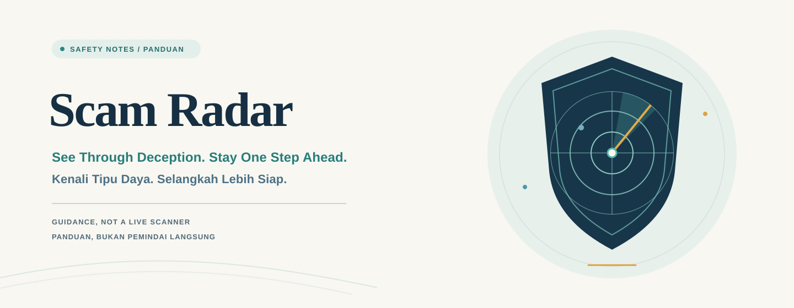

# Scam Radar

[English](#english) · [Bahasa Indonesia](#bahasa-indonesia)

## English

### What this is

This repository contains fraud-assessment guidance in [`SKILL.md`](./SKILL.md). It helps assess suspicious messages, calls, sites, offers, and payment or identity requests by separating observations from uncertainty and prioritizing protective next steps. It is guidance—not a live scanner, identity checker, or verification service.

### Quick use

Use `SKILL.md` as guidance in an assistant workflow that supports skills, or follow it as a checklist. Describe only what is needed, including whether you clicked, replied, paid, or installed anything.

> “A text says my package is held and asks me to open [LINK REDACTED]. I have not clicked or shared anything. What should I check, and what are the safest next steps?”

### Privacy and redaction

Share the minimum necessary. Replace personal details with placeholders such as `[NAME]`, `[PHONE]`, `[ACCOUNT]`, `[LINK]`, and `[CODE]`. Never share passwords, one-time or recovery codes, full card/bank/account numbers, government ID numbers, private keys, session cookies, unredacted links, or QR codes. If a domain is needed, share the domain only—not the full URL, path, or query.

### Workflow

1. Check immediate safety; pause contact, payment, and further sharing.
2. Note what was clicked, opened, sent, paid, installed, or granted access.
3. Separate observed facts from assumptions and unknowns.
4. Contain any account, payment, identity, or device exposure.
5. Verify independently through a known-good official channel; report using contact details reached independently.
6. Finish with a short, prioritized action checklist.

### Limits

The guidance cannot identify a sender or confirm a live website or contact unless a reliable source or tool is actually used. It cannot guarantee recovery or legal, financial, or security outcomes. Do not confront or retaliate against suspected scammers. For active payment or account-access risk, contact the relevant provider through its official app, card, or a known-good website.

## Bahasa Indonesia

### Tentang repositori ini

Repositori ini berisi panduan penilaian penipuan di [`SKILL.md`](./SKILL.md). Panduan membantu menilai pesan, panggilan, situs, tawaran, serta permintaan pembayaran atau identitas yang mencurigakan dengan memisahkan fakta yang terlihat dari ketidakpastian dan memprioritaskan langkah perlindungan. Ini adalah panduan—bukan pemindai langsung, pemeriksa identitas, atau layanan verifikasi.

### Penggunaan singkat

Gunakan `SKILL.md` sebagai panduan dalam alur kerja asisten yang mendukung skill, atau ikuti sebagai daftar periksa. Jelaskan hanya hal yang diperlukan, termasuk apakah Anda sudah mengeklik tautan, membalas, membayar, atau memasang sesuatu.

> “Ada pesan yang mengatakan paket saya tertahan dan meminta saya membuka [TAUTAN DIHAPUS]. Saya belum mengeklik atau membagikan apa pun. Apa yang perlu saya periksa, dan apa langkah paling aman berikutnya?”

### Privasi dan penyamaran data

Bagikan informasi sesedikit mungkin. Ganti detail pribadi dengan penanda seperti `[NAMA]`, `[TELEPON]`, `[AKUN]`, `[TAUTAN]`, dan `[KODE]`. Jangan pernah membagikan kata sandi, kode sekali pakai atau pemulihan, nomor kartu/bank/akun lengkap, nomor identitas pemerintah, kunci privat, cookie sesi, tautan, atau kode QR tanpa disamarkan. Jika nama domain diperlukan, bagikan nama domain saja—bukan URL lengkap, jalur, atau parameternya.

### Alur kerja

1. Periksa keselamatan langsung; hentikan sementara komunikasi, pembayaran, dan pembagian informasi.
2. Catat apa yang sudah diklik, dibuka, dikirim, dibayar, dipasang, atau diberi akses.
3. Pisahkan fakta yang terlihat dari asumsi dan hal yang belum diketahui.
4. Batasi dampak pada akun, pembayaran, identitas, atau perangkat.
5. Verifikasi secara mandiri melalui kanal resmi yang sudah tepercaya; laporkan melalui kontak yang ditemukan secara mandiri.
6. Akhiri dengan daftar tindakan singkat yang diurutkan menurut prioritas.

### Batasan

Panduan ini tidak dapat mengidentifikasi pengirim atau memastikan situs maupun kontak yang aktif kecuali sumber atau alat tepercaya benar-benar digunakan. Panduan ini tidak menjamin pemulihan atau hasil hukum, keuangan, maupun keamanan. Jangan mengonfrontasi atau membalas pihak yang dicurigai menipu. Jika pembayaran atau akses akun sedang berisiko, hubungi penyedia terkait melalui aplikasi resmi, kartu, atau situs web yang sudah tepercaya.
